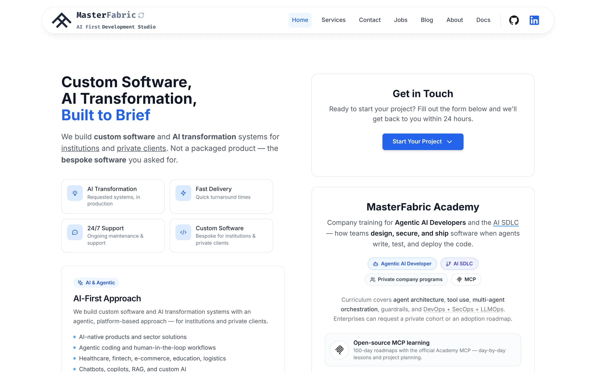
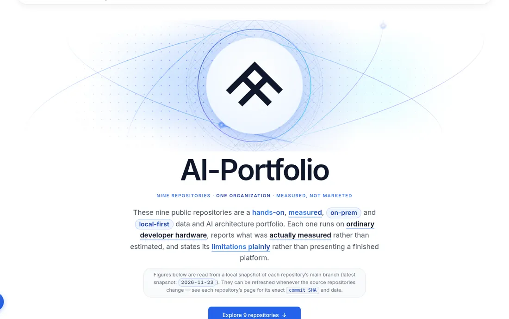

<div align="center">
  <picture>
    <source media="(prefers-color-scheme: dark)" srcset="docs/assets/masterfabric-logo-dark.svg">
    
  </picture>

  <h1>MasterFabric Inc.</h1>

  <p><strong>Custom Software &amp; AI Development Studio</strong></p>

  <p>
    <a href="https://img.shields.io/github/package-json/v/masterfabric-mobile/masterfabric-website"></a>
    <a href="https://nextjs.org/"></a>
    <a href="https://www.typescriptlang.org/"></a>
    <a href="https://tailwindcss.com/"></a>
    <a href="https://www.masterfabric.co"></a>
    <a href="LICENSE"></a>
  </p>

  <p>
    <a href="https://www.masterfabric.co">Website</a>
    &nbsp;·&nbsp;
    <a href="https://www.masterfabric.co/changelog">Changelog</a>
    &nbsp;·&nbsp;
    <a href="https://www.masterfabric.co/ai-portfolio">AI Portfolio</a>
    &nbsp;·&nbsp;
    <a href="https://www.masterfabric.co/privacy">Privacy</a>
  </p>

  <br>

  
</div>

## About

This repository is the public website of [MasterFabric Information Technology Inc.](https://www.masterfabric.co), an Ankara studio that builds custom software and AI transformation systems for institutions and private clients — including iOS, Android, and HarmonyOS apps designed around the brief you send us.

The site is a **Next.js 14** App Router app with a **static export**. Merges to `dev` are production: Vercel auto-deploys them to [www.masterfabric.co](https://www.masterfabric.co).

## AI Portfolio

<div align="center">
  
</div>

[`/ai-portfolio`](https://www.masterfabric.co/ai-portfolio) presents nine public MasterFabric repositories as a measured, on-prem and local-first data and AI architecture portfolio, with simulations built from the measured results and one page per repository at `/ai-portfolio/<slug>/`. The homepage links to it from a bar above the Claude Partner Network section.

## Tech stack

- **[Next.js](https://nextjs.org/) 14.2** — App Router, static export (`output: 'export'`)
- **[React](https://react.dev/) 18** and **[TypeScript](https://www.typescriptlang.org/) 5**
- **[Tailwind CSS](https://tailwindcss.com/) 3** with `@tailwindcss/typography`
- **[Vercel](https://vercel.com/)** — hosting and [Web Analytics](https://vercel.com/docs/analytics)
- **[Iconify](https://iconify.design/)** and **[Lucide](https://lucide.dev/)** for icons
- Markdown posts under `src/content/blog/`

## Project structure

```
src/
├── app/                 # App Router pages (static routes)
│   ├── about/
│   ├── ai-portfolio/    # /ai-portfolio and /ai-portfolio/<slug>/
│   ├── blog/
│   ├── changelog/       # Renders CHANGELOG.md at build time
│   ├── contact/
│   ├── jobs/
│   ├── privacy/         # /privacy and /privacy/<bundleId>/
│   ├── privacy-policy/
│   ├── services/
│   ├── terms-of-use/
│   └── yapay-zeka-donusumu/
├── components/          # Layout, forms, pages, SEO, UI
│   └── ai-portfolio/    # AI Portfolio hero, cards, gallery, simulations
├── content/blog/        # Markdown blog posts
├── data/                # Apps, policies, navigation, page copy
│   └── ai-portfolio/    # One JSON file per portfolio repository
├── lib/                 # SEO, version, privacy-policy helpers
├── styles/
└── utils/
```

## Getting started

```bash
git clone https://github.com/masterfabric-mobile/masterfabric-website.git
cd masterfabric-website
npm ci
npm run dev
```

The dev server is at [http://localhost:3000](http://localhost:3000).

```bash
npm run build      # static export to out/
npm run preview    # serve out/ on port 3000
npm run lint
```

## Releasing

`dev` is the production branch. A merge to `dev` is auto-deployed to [www.masterfabric.co](https://www.masterfabric.co). The footer and `/changelog` read the version from `package.json` at build time.

1. Bump `version` in `package.json` and the root version fields in `package-lock.json`.
2. Add a new section at the top of `CHANGELOG.md` (Keep a Changelog).
3. Open a pull request into `dev` and merge it.
4. Tag the merge commit `vX.Y.Z` and publish a GitHub Release from the new changelog section.

## Adding an app privacy policy

Each published app gets a page at `/privacy/<bundleId>/`.

1. Append an entry to [`src/data/apps.ts`](src/data/apps.ts). Use the real bundle ID; it becomes the URL. Fill the factual fields honestly — they drive the generated policy text. Keep `draft: true` until legal has reviewed it, then set `draft: false`.
2. Add the reviewed full policy text to [`src/data/app-policies.ts`](src/data/app-policies.ts), keyed by the same bundle ID. When a full text exists, the page renders that instead of the generated template.
3. Add `/privacy/<bundleId>/` to [`public/sitemap.xml`](public/sitemap.xml).

## Updating the AI Portfolio

Each repository on `/ai-portfolio` is one JSON file in [`src/data/ai-portfolio/data/`](src/data/ai-portfolio/data/) (slug, title, tagline, GitHub URL, snapshot SHA and date, summary, key results, limitations, images).

1. Edit the repository's JSON file, or add a new one and register it in [`src/data/ai-portfolio/repos.ts`](src/data/ai-portfolio/repos.ts) in the order it should appear.
2. Put its images under `public/ai-portfolio/images/<slug>/` (`hero.png` is the card and page cover) and reference them as `/ai-portfolio/images/<slug>/...` in the JSON.
3. Only use figures measured in the source repository, and update the snapshot SHA and date with them. The simulations in [`src/components/ai-portfolio/sims/data.ts`](src/components/ai-portfolio/sims/data.ts) quote sentences from the `keyResults` in these files, and the build fails if a quoted sentence no longer matches, so update both together.

## Contributing

Please open pull requests against `dev`. Keep changes focused, and do not invent metrics or policy text.

- Website: [www.masterfabric.co](https://www.masterfabric.co)
- Changelog: [www.masterfabric.co/changelog](https://www.masterfabric.co/changelog)
- Issues and PRs: [github.com/masterfabric-mobile/masterfabric-website](https://github.com/masterfabric-mobile/masterfabric-website)
- Organization: [github.com/masterfabric-mobile](https://github.com/masterfabric-mobile)

## License

This repository is licensed under the [GNU Affero General Public License v3.0](LICENSE).
